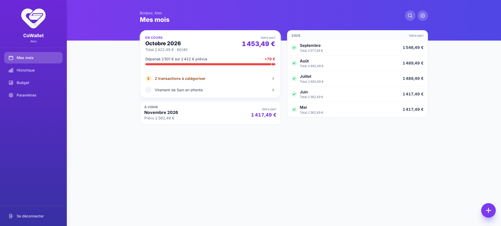
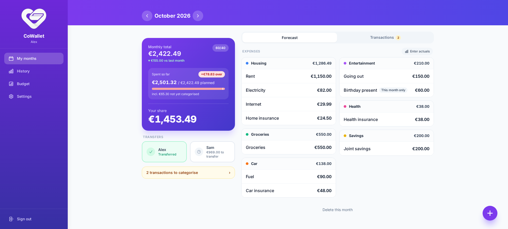
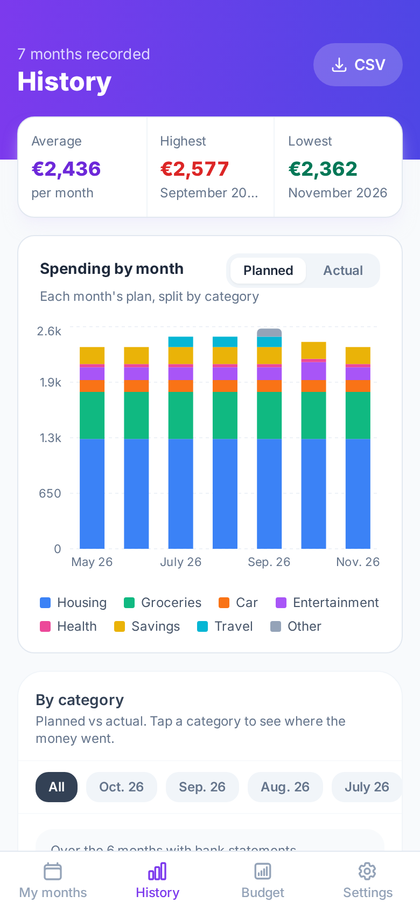
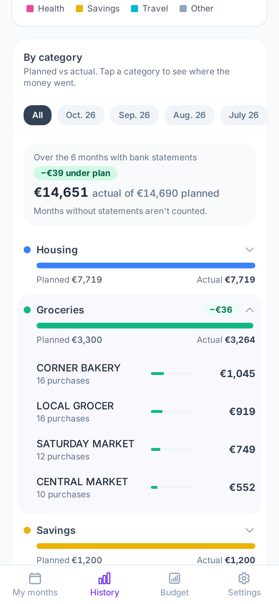

# CoWallet

<p align="center">
  
</p>

Most finance apps are built for one person. CoWallet is built for two. A self-hosted shared dashboard to track expenses, plan ahead, and stay aligned on your budget.

*An open source, Docker-deployable expense tracker for couples. Budget planning, bank sync, and real-time notifications. Installable on iOS and Android.*

## Features

### Budget & Expenses
- **Monthly tracking** - create a month, add charges, see each person's share and transfer, mark transfers as done
- **Configurable split** - 50/50, 60/40, or any ratio you want
- **Recurring charges** - automatically copied to the next month
- **Installment payments** - split a purchase over N months, auto-carried forward
- **Actual vs planned** - enter real amounts alongside budgeted ones, see the delta
- **Bulk delete** - select and delete multiple months at once

### Categories & Organization
- **Charge suggestions** - autocomplete based on past entries
- **Custom categories** - create categories with icon and color
- **Custom payment methods** - add your own payment methods
- **Search** - find any charge or bank transaction across all months

### Bank Sync (optional)
- **Connect your bank** - link a joint account via Enable Banking (supports 2000+ banks across Europe)
- **Automatic import** - new debits arrive every morning (7:00, Europe/Paris), retried once at noon if the bank is unreachable
- **Manual import** - import transactions month by month, with debit filter and duplicate detection
- **Auto-categorization** - transactions are categorized from past imports, recognizing the same merchant across stores (never for PayPal or bank transfers, where each payment can be for something different)
- **Full bank label** - payment reason, loan instalment breakdown, real purchase date, and who paid (from each person's card's last 4 digits)
- **Budget vs actual** - compare planned charges against real spending, category by category
- **Access reminder** - banks cut the access after 90 to 180 days: you are reminded before it expires

### History & Analytics
- **History & charts** - monthly evolution (planned or actual), and planned vs actual by category over the months with bank statements; open a category to see where the money went, merchant by merchant
- **Personal budget** - each person plans their own income, personal expenses and investments, visible only to them
- **Sankey diagram** - visualize income, shared expenses, personal spending and investments
- **CSV export** - keep a backup of all your data

### Collaboration
- **Multi-user** - invite your partner via a private invite link
- **Push notifications** - your partner's changes, new bank transactions, over-budget alerts and a monthly reminder, each one switchable per person (iOS & Android)
- **Group isolation** - each couple's data is fully isolated

### App & Security
- **PWA** - installable on iOS (Safari) and Android home screen
- **English & French** - interface language switchable in settings
- **Rate-limited login** - brute-force protection on the auth endpoint
- **Password policy** - minimum 12 characters
- **First-run setup** - no config file needed, just open the app

## Screenshots

<p align="center">
  
  
  
  
</p>

## Quick Start

### 1. Create a `docker-compose.yml`

A `docker-compose.example.yml` is provided as a starting point. Copy it and adjust to your setup:

```bash
cp docker-compose.example.yml docker-compose.yml
```

Replace `<host_folder_data>` with the folder on your host where data will be stored (e.g. `/home/user/cowallet/data`).

```yaml
services:
  cowallet:
    image: ghcr.io/ninidas/cowallet:latest
    container_name: cowallet
    restart: unless-stopped
    ports:
      - "8000:8000"
    environment:
      - PUID=1000
      - PGID=1000
      - APP_LANG=en  # Default language for seeded data: en or fr
    volumes:
      - <host_folder_data>:/data
```

Then start with `docker compose up -d`. The app is available at `http://localhost:8000`. Point your reverse proxy (Traefik, nginx, Caddy…) to port 8000 of the `cowallet` container.

### 2. First run

Open the app in your browser - you'll be guided through a setup wizard to create two user accounts and configure the default split ratio.

## Bank Sync

Bank sync is **optional**. The app works fully without it - it only adds the ability to import real transactions from your bank and compare them to your planned budget.

It uses [Enable Banking](https://enablebanking.com), an open banking aggregator supporting 2000+ banks across Europe (France, Belgium, Spain, Germany, Italy, Netherlands…). A free tier is available and is sufficient for personal use.

### 1. Generate an RSA key pair

```bash
openssl genpkey -algorithm RSA -out enablebanking.pem -pkeyopt rsa_keygen_bits:4096
openssl rsa -in enablebanking.pem -pubout -out enablebanking_pub.pem
```

Keep `enablebanking.pem` private - you will mount it into the container.  
You will upload `enablebanking_pub.pem` to the Enable Banking dashboard in the next step.

### 2. Create an Enable Banking account

1. Go to [enablebanking.com](https://enablebanking.com) and sign up
2. Create a new application in the dashboard
3. Upload `enablebanking_pub.pem` as the public key for your application
4. Note your **App ID**

### 3. Register your callback URL

In your Enable Banking application settings, add the following redirect URI:

```
https://your-domain.com/bank/callback
```

### 4. Update your `docker-compose.yml`

Add the following environment variables and volume to the `cowallet` service. Replace `<host_folder_secrets>` with the folder containing your `enablebanking.pem` file (e.g. `/home/user/cowallet/secrets`).

```yaml
    environment:
      - ENABLEBANKING_APP_ID=your-app-id
      - ENABLEBANKING_PRIVATE_KEY_PATH=/backend/secrets/enablebanking.pem
    volumes:
      - <host_folder_secrets>:/backend/secrets
```

Once configured, a **Bank connection** section appears in the app settings where you can connect your bank account.

## Push Notifications

Push notifications are supported on mobile (iOS and Android). To receive them, install the app on your phone first (Chrome or Safari: use "Add to Home Screen"), then open the app and go to **Settings › Notifications**. No server configuration needed.

"On this device" turns notifications on for the phone or computer you are using. Each person then chooses what they receive, on all their devices:

| Notification | When |
|--------------|------|
| **Your partner's changes** | Month created, charge added, edited or deleted, transfer done. Charges added in a row are grouped into one notification, sent 2 minutes after the last one. |
| **Bank** | New transactions after the morning import, failed import, bank access about to expire |
| **Over budget** | The first time in a month that actual spending goes over the plan, in total or in a category (checked after each import) |
| **Reminder on the 28th** | Next month doesn't exist yet |

## Configuration

All variables are optional. The app runs without any of them.

| Variable | Description |
|----------|-------------|
| `SECRET_KEY` | JWT signing key - auto-generated and persisted on first run if not set |
| `PUID` | User ID to run the backend process as (default: 0 / root) |
| `PGID` | Group ID to run the backend process as (default: 0 / root) |
| `APP_LANG` | Default language for seeded data: `en` (default) or `fr`. Sets the language of default categories and payment methods on first setup. |
| `MAX_GROUPS` | Maximum number of groups allowed to register. Defaults to `1`. Set to a higher value to allow multiple couples on the same instance. |
| `ENABLEBANKING_APP_ID` | Enable Banking app ID - required for bank sync |
| `ENABLEBANKING_PRIVATE_KEY_PATH` | Path to the RSA private key inside the container - required for bank sync |
| `AUTO_IMPORT` | Set to `0` to disable the automatic morning import (e.g. on a test instance sharing the bank connection: banks limit reads to about 4 per day) |

## Tech Stack

- **Frontend** - React, Vite, Tailwind CSS, Recharts, PWA
- **Backend** - FastAPI, SQLAlchemy, SQLite
- **Auth** - JWT (python-jose), bcrypt
- **Push** - Web Push API, VAPID (pywebpush), compatible iOS 16.4+ and Android
- **Proxy** - nginx

## License

AGPL-3.0 - see [LICENSE](LICENSE)
